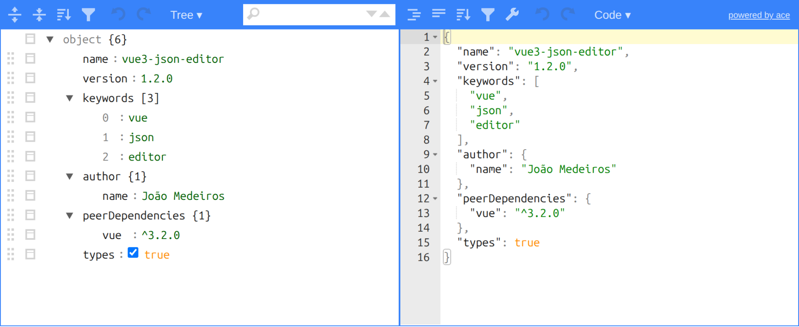

<div align="center">

# vue3-json-editor

A JSON editor component for **Vue 3**, powered by [jsoneditor](https://github.com/josdejong/jsoneditor).
View, edit, format and validate JSON in tree, code, form, text and view modes.

[](https://www.npmjs.com/package/vue3-json-editor)
[](https://www.npmjs.com/package/vue3-json-editor)
[](https://vuejs.org/)
[](./types/vue3-json-editor.d.ts)
[](./LICENSE)



<sub>The same JSON in <b>tree</b> mode (left) and <b>code</b> mode (right).</sub>

</div>

---

## 📚 Table of contents

- [Features](#-features)
- [Installation](#-installation)
- [Quick start](#-quick-start)
- [Props](#%EF%B8%8F-props)
- [Events](#-events)
- [Examples](#-examples)
- [Styling](#-styling)
- [Builds and environments](#-builds-and-environments)
- [Compatibility](#-compatibility)
- [Limitations](#%EF%B8%8F-limitations)
- [Project status and roadmap](#%EF%B8%8F-project-status-and-roadmap)
- [Development](#%EF%B8%8F-development)
- [Credits](#-credits)

## ✨ Features

- 🌳 **Five modes**: `tree`, `code`, `form`, `text` and `view`, switchable from the editor menu or the `mode` prop
- 🔁 **Two-way `v-model`**: the bound variable updates on every valid edit
- ✅ **Validation**: syntax errors are marked in code mode and reported through `@has-error`
- 📏 **Fixed height** in every mode with the `height` prop
- 🧩 **Full jsoneditor access**: pass any [jsoneditor option](https://github.com/josdejong/jsoneditor/blob/master/docs/api.md#configuration-options) with `options`, or get the editor instance with `@provide-editor`
- 🎨 **Zero CSS setup**: styles and icons are injected when the package is imported
- 📦 **ESM, CommonJS and UMD** builds, with TypeScript declarations
- 🖥️ **SSR-safe**: renders on the server and creates the editor in the browser

## 📦 Installation

```bash
npm install vue3-json-editor
# or
yarn add vue3-json-editor
# or
pnpm add vue3-json-editor
```

`vue` is a peer dependency: the component uses your app's Vue (`^3.2.0`).

## 🚀 Quick start

```vue
<script setup>
import { ref } from 'vue'
import { Vue3JsonEditor } from 'vue3-json-editor'

const json = ref({ hello: 'world' })

function onError (error) {
  console.warn('Invalid JSON:', error.message)
}
</script>

<template>
  <Vue3JsonEditor
    v-model="json"
    mode="tree"
    :show-btns="true"
    :expanded-on-start="true"
    @has-error="onError"
  />
</template>
```

To register it globally:

```js
import { createApp } from 'vue'
import { Vue3JsonEditor } from 'vue3-json-editor'
import App from './App.vue'

createApp(App).component('Vue3JsonEditor', Vue3JsonEditor).mount('#app')
```

## ⚙️ Props

| Prop | Type | Default | Description |
|---|---|---|---|
| `v-model` / `modelValue` | `Object \| Array \| String \| Boolean` | — | The JSON value. Edits in the editor update it (two-way); changing it from outside updates the editor. |
| `mode` | `String` | `'tree'` | Editor mode: `'tree'`, `'code'`, `'form'`, `'text'` or `'view'`. Changing it after mount switches the mode (1.2.1+). |
| `modes` | `Array` | all five modes | Modes listed in the editor's mode menu, e.g. `['code', 'tree']`. Read when the editor is created. |
| `show-btns` | `Boolean` | `false` | Shows the save button below the editor. Clicking it emits `json-save`. It is disabled while the JSON is invalid. |
| `expanded-on-start` | `Boolean` | `false` | Expands all nodes in `tree`, `view` and `form` modes when the editor starts (and when `v-model` is replaced from outside). |
| `lang` | `String` | `'en'` | Language of the save button: `'en'` (SAVE), `'it'` (SALVA) or `'zh'` (保存). Other values fall back to English (1.2.1+). |
| `height` | `Number \| String` | — | Height of the editor area (without the save button), the same in every mode. A number is in px (`:height="400"`), a string is any CSS value (`height="60vh"`). Not set: the editor keeps its default minimum height, which differs between modes. Since 1.2.0. |
| `options` | `Object` | `{}` | Extra [jsoneditor options](https://github.com/josdejong/jsoneditor/blob/master/docs/api.md#configuration-options), applied when the editor is created. `mode` and `modes` always come from the props above; your `onChange` / `onModeChange` are called after the component's own. Since 1.2.0. |

## 📣 Events

| Event | Payload | When |
|---|---|---|
| `update:modelValue` | the new JSON | On every valid edit. Used by `v-model`. Since 1.2.0. |
| `json-change` | the new JSON | On every valid edit. |
| `input` | the new JSON | On every valid edit. Kept for compatibility; prefer `v-model`. |
| `has-error` | `Error` | When the content is not valid JSON (in `code` and `text` modes), or when switching modes through the `mode` prop fails because of it (1.2.1+). |
| `json-save` | the current JSON | When the save button is clicked (`show-btns`). |
| `mode-change` | the new mode (`String`) | When the mode changes, from the editor menu or the `mode` prop. |
| `provide-editor` | the jsoneditor instance | Once, right after the editor is created. |

Changing `v-model` from outside does not emit any of these events.

## 🧪 Examples

<details>
<summary><b>Code mode with a fixed height and a save button</b></summary>

```vue
<script setup>
import { ref } from 'vue'
import { Vue3JsonEditor } from 'vue3-json-editor'

const config = ref({ retries: 3, endpoints: ['https://api.example.com'] })

function save (value) {
  console.log('saving', value)
}
</script>

<template>
  <Vue3JsonEditor
    v-model="config"
    mode="code"
    :modes="['code', 'tree']"
    :height="400"
    :show-btns="true"
    @json-save="save"
  />
</template>
```

</details>

<details>
<summary><b>Controlling the mode from your app</b></summary>

```vue
<script setup>
import { ref } from 'vue'
import { Vue3JsonEditor } from 'vue3-json-editor'

const json = ref({ a: 1 })
const mode = ref('tree')
</script>

<template>
  <button @click="mode = 'code'">Edit as code</button>
  <button @click="mode = 'tree'">Edit as tree</button>

  <!-- the menu inside the editor keeps working; @mode-change keeps `mode` in sync -->
  <Vue3JsonEditor v-model="json" :mode="mode" @mode-change="mode = $event" />
</template>
```

Requires 1.2.1+. In 1.2.0 and earlier, `mode` is only read when the editor is created; recreate it with `:key="mode"` instead.

</details>

<details>
<summary><b>jsoneditor options (navigation bar, status bar, UI language, schema)</b></summary>

```vue
<template>
  <Vue3JsonEditor
    v-model="json"
    :options="{
      navigationBar: true,
      statusBar: true,
      language: 'pt-BR',
      schema: { type: 'object', required: ['name'] }
    }"
  />
</template>
```

`options` is passed as is to jsoneditor, so everything in its [configuration docs](https://github.com/josdejong/jsoneditor/blob/master/docs/api.md#configuration-options) is available. jsoneditor's navigation bar (tree, view and form modes) and status bar (code and text modes) are off by default in this component, to keep the layout of previous versions.

</details>

<details>
<summary><b>Using the jsoneditor instance</b></summary>

```vue
<script setup>
import { shallowRef } from 'vue'
import { Vue3JsonEditor } from 'vue3-json-editor'

const editor = shallowRef(null)
</script>

<template>
  <Vue3JsonEditor v-model="json" @provide-editor="editor = $event" />
  <button @click="editor?.expandAll()">Expand all</button>
  <button @click="editor?.focus()">Focus</button>
</template>
```

See the [jsoneditor API](https://github.com/josdejong/jsoneditor/blob/master/docs/api.md#methods) for all methods.

</details>

## 🎨 Styling

You don't need to import any CSS: when the package is imported, it adds jsoneditor's styles and its own to the page `<head>`, once.

To customize, target these classes in your own CSS:

| Class | Element |
|---|---|
| `.jsoneditor-vue` | the container of the editor |
| `.jsoneditor-vue-fixed-height` | the container, when `height` is set |
| `.jsoneditor-btns` | the area below the editor with the save button |
| `.json-save-btn` | the save button |
| `.jsoneditor`, `.jsoneditor-menu`, … | jsoneditor's own elements |

## 📦 Builds and environments

| File | Format | Used by | jsoneditor |
|---|---|---|---|
| `dist/vue3-json-editor.esm.prod.js` | ES module | `module` field: Vite, webpack, Rollup | imported from `node_modules` when the editor mounts |
| `dist/vue3-json-editor.cjs.prod.js` | CommonJS | `main` field: Node, Jest | required from `node_modules` when the editor mounts |
| `dist/vue3-json-editor.umd.prod.js` | UMD | `unpkg` field: `<script>` tags | bundled in the file |
| `dist/index.d.ts` | TypeScript | `typings` field | — |

Non-minified builds are also included (`.esm.js`, `.cjs.js`, `.umd.js`). All builds target **ES2015**.

| Environment | Status | Notes |
|---|---|---|
| Vite, webpack and other bundlers | ✅ | `import { Vue3JsonEditor } from 'vue3-json-editor'` |
| SSR (`renderToString`, Nuxt) | ✅ | The server renders an empty container; the editor is created in the browser. |
| Node `import` / `require` | ✅ | Loading the package doesn't touch `window`. |
| Jest / Vitest with jsdom | ✅ | Tested with a CommonJS jsdom setup. |
| `<script>` tag (UMD) | ✅ | Load Vue first; the component is `window['vue3-json-editor'].Vue3JsonEditor`. |
| TypeScript | ✅ | Props are typed. Events are not typed yet. |
| Vue 2 | ❌ | Use [vue-json-editor](https://github.com/dirkliu/vue-json-editor). |

<details>
<summary><b>UMD example</b></summary>

```html
<div id="app">
  <vue3-json-editor v-model="json" mode="code"></vue3-json-editor>
</div>

<script src="https://unpkg.com/vue@3/dist/vue.global.prod.js"></script>
<script src="https://unpkg.com/vue3-json-editor"></script>
<script>
  const { Vue3JsonEditor } = window['vue3-json-editor']
  Vue.createApp({ data: () => ({ json: { hello: 'world' } }) })
    .component('Vue3JsonEditor', Vue3JsonEditor)
    .mount('#app')
</script>
```

</details>

## ✅ Compatibility

| | Supported | Tested |
|---|---|---|
| Vue | `^3.2.0` | 3.2.0, 3.2.47, 3.3.13, 3.5.45 |
| jsoneditor | `^10.4.3` (installed with the package) | 10.4.3 |
| Browsers | any browser with ES2015 support (every browser Vue 3 runs on) | Chromium |

Every change is checked by a contract test suite that installs the packed package like a user would and runs it in a real browser and in Node, once per Vue version above.

## ⚠️ Limitations

- **Read once, when the editor is created:** `modes`, `options` and `expanded-on-start`. To change them later, recreate the component with a `:key`. (`mode` is also read once in 1.2.0 and earlier.)
- **`lang` only changes the save button.** jsoneditor's own interface (menus, tooltips) follows its `language` option: `:options="{ language: 'pt-BR' }"`.
- **`height` in percent** only works if every parent element up the chain has a defined height.
- **`has-error`** only fires in `code` and `text` modes; in the other modes the content is always valid JSON.
- **Bundle size:** jsoneditor itself is about 1 MB minified (about 280 kB gzipped). The ESM and CommonJS builds load it when the editor mounts; the UMD build includes it.
- **Global CSS:** the styles are added to the page once and can't be turned off.
- **TypeScript:** events are not part of the type declarations yet.
- **Old Vue 3.2 releases**, limitations of Vue itself:
  - with Vue 3.2.0, server rendering gives the container the id `jsoneditor-vue-undefined`;
  - type checking with `skipLibCheck: false` fails inside Vue's own type declarations on early 3.2 releases. `skipLibCheck: true`, the default in Vue templates, works.
- **Chinese and other IME input** works in our tests with a simulated IME in Chromium. Real-keyboard feedback is welcome in [#25](https://github.com/joaomede/vue3-json-editor/issues/25).

## 🗺️ Project status and roadmap

- **Current version: 1.2.1**, compatible with **Vue 3.2 to 3.5** (`^3.2.0`), using jsoneditor 10. See the [CHANGELOG](./CHANGELOG.md) for what changed and the upgrade notes.
- **Coming soon: 2.x**, a new major version with significant and interesting changes to the library. It won't be backwards compatible with 1.x.

Found a bug? Please [open an issue](https://github.com/joaomede/vue3-json-editor/issues) with your Vue version, your setup (Vite, Nuxt, webpack…) and a small example.

## 🛠️ Development

```bash
npm install

# run the demo (demo/) against the component source
npm run dev

# build the library into dist/
npm run build

# build, pack and run the contract test suite (contract-tests/) against the packed package
npm run test:contract

# same, once per supported Vue version (3.2.0, 3.2.47, 3.3, 3.5)
npm run test:contract:matrix
```

## 🙏 Credits

- Forked from [vue-json-editor](https://github.com/dirkliu/vue-json-editor) by dirkliu.
- Powered by [jsoneditor](https://github.com/josdejong/jsoneditor) by Jos de Jong.
- Thanks to everyone who [contributed](https://github.com/joaomede/vue3-json-editor/graphs/contributors) code, issues and feedback.

## 📄 License

[ISC](./LICENSE)
